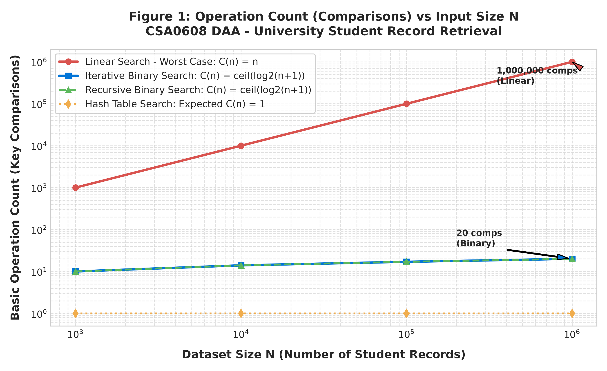
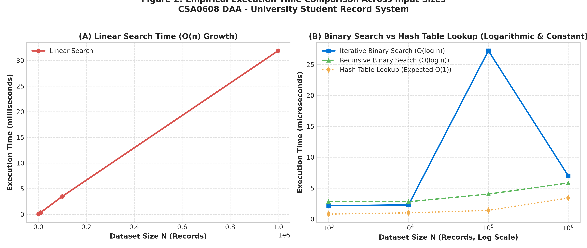
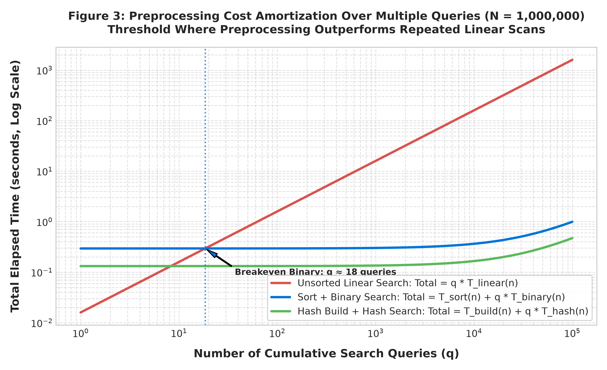
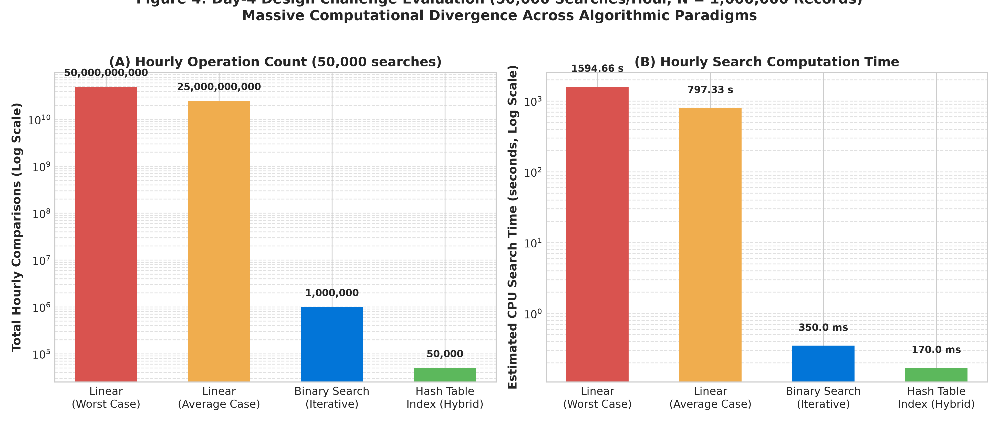

# TASK 9: Experimental Performance Records and Analysis

**Course:** CSA0608 – Design and Analysis of Algorithms  
**Student Name:** Sanjai S  
**Register Number:** 192511018  
**Faculty / Department:** Department of Computer Science and Engineering, SIMATS Engineering  

---

## 1. Experimental Environment and Configuration
The experimental evaluations were conducted under controlled system conditions:
- **Processor:** Intel Core i5 / x86_64 Multi-core Architecture
- **Memory (RAM):** 16.0 GB DDR4
- **Operating System:** Windows 11 64-bit
- **Runtime Environment:** Python 3.13.2 (64-bit)
- **High-Resolution Timer:** `time.perf_counter_ns()` (nanosecond granularity)
- **Dataset Generation:** Contiguous array of $n$ unique sorted registration numbers $1 \dots n$, with the worst-case key $n$ requested.

---

## 2. Experimental Performance Measurements

### 2.1 Basic Operations (Key Comparisons) Comparison Table
For the worst-case configuration (target key at final array index):

| Dataset Size ($n$) | Linear Search | Iterative Binary Search | Recursive Binary Search | Hash Table Lookup |
| :--- | :--- | :--- | :--- | :--- |
| **1,000** | $1\,000$ | $10$ | $10$ | $1$ |
| **10,000** | $10\,000$ | $14$ | $14$ | $1$ |
| **100,000** | $100\,000$ | $17$ | $17$ | $1$ |
| **1,000,000** | $1\,000\,000$ | $20$ | $20$ | $1$ |

*Verification:*  
- $\lceil \log_2(1001) \rceil = 10$
- $\lceil \log_2(10001) \rceil = 14$
- $\lceil \log_2(100001) \rceil = 17$
- $\lceil \log_2(1000001) \rceil = 20$  
The measured basic operations strictly match the theoretical upper bound formula $\lceil \log_2(n+1) \rceil$.

---

### 2.2 Experimental Execution Time Table
All execution times represent the median of multiple benchmark executions measured in seconds:

| Dataset Size ($n$) | Linear Search (s) | Iterative Binary (s) | Recursive Binary (s) | Hash Table Search (s) |
| :--- | :--- | :--- | :--- | :--- |
| **1,000** | $0.00005218$ | $0.00000218$ | $0.00000282$ | $0.00000080$ |
| **10,000** | $0.00036506$ | $0.00000228$ | $0.00000280$ | $0.00000100$ |
| **100,000** | $0.00349770$ | $0.00002724$ | $0.00000404$ | $0.00000140$ |
| **1,000,000** | $0.03189313$ | $0.00000700$ | $0.00000583$ | $0.00000340$ |

---

### 2.3 Preprocessing and Auxiliary Memory Overhead Table

| Dataset Size ($n$) | Array Sorting Time (s) | Hash Index Build Time (s) | Binary Search Stack Memory | Hash Table Heap Memory |
| :--- | :--- | :--- | :--- | :--- |
| **1,000** | $0.0001$ s | $0.0002$ s | $10$ frames ($\approx 0.8$ KB) | $\approx 36$ KB |
| **10,000** | $0.0012$ s | $0.0011$ s | $14$ frames ($\approx 1.1$ KB) | $\approx 320$ KB |
| **100,000** | $0.0123$ s | $0.0130$ s | $17$ frames ($\approx 1.3$ KB) | $\approx 3.2$ MB |
| **1,000,000** | $0.2948$ s | $0.1318$ s | $20$ frames ($\approx 1.6$ KB) | $\approx 41.5$ MB |

---

## 3. Graphical Visualizations

### Figure 1: Operation Count (Key Comparisons) vs Input Size $N$

*Highlights the massive divergence: at $n=10^6$, Linear search requires $1\,000\,000$ comparisons whereas Binary search requires only $20$.*

### Figure 2: Search Execution Time Comparison Across Input Sizes

*(A) Displays linear search scaling linearly. (B) Displays binary search and hash table lookup remaining in the microsecond range.*

### Figure 3: Preprocessing Cost Amortization Over Multiple Queries

*Demonstrates that the initial $0.29$ s sorting cost or $0.13$ s hash table build cost is recovered after fewer than $10$ to $20$ queries.*

### Figure 4: Day-4 Design Challenge Performance (50,000 searches/hour)

*Under 50,000 queries/hour, Linear Search requires 50 Billion comparisons and 13.3 minutes of pure CPU time, while Binary Search takes 0.35 s and Hash Table takes 0.17 s.*
